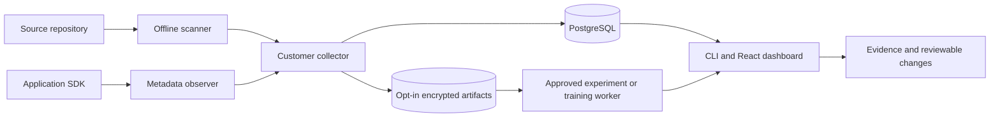

# Cutback

Find AI costs. Test alternatives. Review every change.

Cutback discovers AI calls, observes supported runtime usage, evaluates authorized alternatives, and prepares reviewable changes. Apache-2.0 includes the CLI, collector, PostgreSQL, worker, encrypted datasets and React dashboard. No corporate account or hosted service is required.

**Pre-alpha, not production validated.** Tests use synthetic provider responses. Real pilot traffic, representative quality validation, paid requests and production deployment remain explicit approval gates. See [progress](https://github.com/CutbackAI/cutback/blob/main/docs/progress.md) and [limitations](https://github.com/CutbackAI/cutback/blob/main/docs/limitations.md).

```sh
python -m pip install --pre cutback
cutback doctor --json
cutback scan /path/to/python/project --json
cutback opportunities --target /path/to/python/project
```

To start from another application, give your coding agent the [independent application onboarding request](https://github.com/CutbackAI/cutback/blob/main/docs/application-onboarding.md). Cutback does not require a reference customer application.

Scanning is offline and never executes the application. Historical tokens, spend, latency and quality remain unknown from source alone. Lower prices establish a candidate, not preserved quality or realized savings.

```sh
uv sync --locked --all-extras --dev
uv run python infra/compose/prepare.py
docker compose -f infra/compose/docker-compose.yml up -d --build
uv run python scripts/demo.py
uv run cutback dashboard --local
```

The demo uses synthetic inference and an actual local collector/database. Dashboard credentials are separate control keys held only in browser memory. Read [deployment](https://github.com/CutbackAI/cutback/blob/main/docs/deployment.md), [evaluation](https://github.com/CutbackAI/cutback/blob/main/docs/evaluation.md), [provider compatibility](https://github.com/CutbackAI/cutback/blob/main/docs/providers.md), and [agent setup](https://github.com/CutbackAI/cutback/blob/main/docs/agent-integration.md).

The dashboard guides project setup, scoped keys, capture policies, CSV/JSON datasets, frozen experiment plans, budget approval and cancellation. It also exposes team access, retention, contract rates, schedules, rollout records, optional billing and local training jobs. Credentials stay in page memory; closing or reloading signs out.


The screenshot uses synthetic data. Unknown prices and incomplete coverage remain visible.

| Capability | What works |
|---|---|
| Discover | Offline Python scanner; optional JavaScript/TypeScript syntax scanning, stable call-site IDs, explicit unresolved coverage |
| Observe | Native pinned OpenAI and Anthropic SDKs, sync/async/streams, retry attempts, bounded fail-open export, separate Node observer |
| Account | PostgreSQL, idempotent ingestion, Decimal pricing, cached/reasoning usage, contract rates, retained summaries and unknown totals |
| Evaluate | Rights-scoped encrypted datasets, independent labels or provisional judges, paired uncertainty, disjoint pilot elimination, one-run hash approvals |
| Optimize | Model/prompt alternatives, native prompt caching, bounded routing, explicit encrypted response cache, local HF/PEFT LoRA training |
| Review | Source-bound model diffs and rollback, approved schedules, canary/guardrail records, evidence tiers and audited actions |
| Operate | Scoped RBAC, OIDC/PKCE, team grants, deletion/export, backup/restore, Compose, Helm and Terraform references |



Extras: `cutback[openai]`, `[anthropic]`, `[instrumentation]`, `[server]`, `[eval]`, `[storage]`, `[identity]`, `[commercial]`, `[javascript]`. The scanner core contains no SDK, server or GPU dependencies. Training uses a separate locked runtime. Optional commercial integrations do not restrict the OSS pipeline.

For JavaScript/TypeScript scanning:

```sh
python -m pip install --pre 'cutback[javascript]'
cutback scan /path/to/app --language python --language javascript --language typescript --json
```

The [Node SDK](https://github.com/CutbackAI/cutback/blob/main/packages/js-sdk/README.md) is supplied as source and a release tarball; npm publication is separate. Exact supported SDK versions and stream limits are in [provider compatibility](https://github.com/CutbackAI/cutback/blob/main/docs/providers.md).

Run [working examples](https://github.com/CutbackAI/cutback/blob/main/examples/README.md) for both providers, FastAPI, Django, threaded workers and Lambda-style bounded flushing. For the complete scanner → native mocked SDK → HTTP → PostgreSQL → encrypted dataset → approved worker → paired report path:

```sh
uv run python examples/experiment_walkthrough.py
```

That walkthrough performs no paid inference and deletes its own synthetic project afterward. It exercises the same collector and worker used by ordinary authorized runs.

Operations guides: [identity and teams](https://github.com/CutbackAI/cutback/blob/main/docs/identity-and-teams.md), [evaluation](https://github.com/CutbackAI/cutback/blob/main/docs/evaluation.md), [advanced optimization](https://github.com/CutbackAI/cutback/blob/main/docs/advanced-optimization.md), [local training](https://github.com/CutbackAI/cutback/blob/main/docs/local-training.md), [continuous operations](https://github.com/CutbackAI/cutback/blob/main/docs/continuous-operations.md), [optional billing](https://github.com/CutbackAI/cutback/blob/main/docs/hosted-billing.md), and [Helm/Terraform](https://github.com/CutbackAI/cutback/blob/main/infra/README.md). Read [security and privacy](https://github.com/CutbackAI/cutback/blob/main/docs/security-and-privacy.md) before authorizing payload capture.

Development uses Python 3.11–3.13, Node 24 and PostgreSQL 17. See [contributing](https://github.com/CutbackAI/cutback/blob/main/CONTRIBUTING.md) for tests and [completion evidence](https://github.com/CutbackAI/cutback/blob/main/docs/product-completion.md) for implemented scope, executed checks and external acceptance gates. No production deployment or real customer savings is implied by a synthetic benchmark.

Watch or reproduce the [synthetic demo](https://github.com/CutbackAI/cutback/blob/main/docs/demo.md). Its data is explicitly labeled; it is not a customer benchmark.
