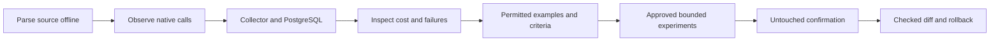

# Cutback

Find expensive or failing AI workflows. Test improvements within an approved budget. Get a checked source change with evidence and rollback.

Cutback is an Apache-2.0 Python tool for an existing application: an offline scanner, native SDK instrumentation, a self-hosted PostgreSQL collector and worker, a dashboard, and commands for your coding agent.

**Pre-alpha.** The examples use synthetic model replies. They exercise real SDKs, HTTP, PostgreSQL, approvals and application checks; they do not establish real model quality, customer savings or production reliability. [Current status and unfinished work](https://github.com/CutbackAI/cutback/blob/main/docs/status.md).

## Run one complete example

Start Docker Desktop with Linux containers. Install Git, Python 3.11–3.13 and uv 0.13.6, then:

```sh
git clone https://github.com/CutbackAI/cutback.git
cd cutback
uv sync --locked --no-dev --extra server --extra openai
uv run --no-sync cutback demo --workload-portfolio
```

Wait for the printed **Ready** address, open it and choose **Explore sample**. No provider key, paid inference or Node setup is needed. The dashboard is included.

| Follow the sample | What to inspect |
|---|---|
| Observe the application | Native calls, source attribution and modeled spend |
| Inspect repeated requests | Why reuse is a hypothesis until separately tested |
| Compare alternatives | Which candidates meet the declared quality requirements |
| Confirm one candidate | A frozen choice tested on separate untouched groups |
| Review the change | Exact source diff, checks on both trees and byte-exact rollback |

Nothing is deployed. Press **Ctrl+C** to remove the command's owned temporary database and encrypted artifacts. [Expected results and troubleshooting](https://github.com/CutbackAI/cutback/blob/main/examples/workload-portfolio/README.md).

Prefer a small application outside this repository? Start with the [standalone support desk](https://github.com/CutbackAI/support-desk-example). It runs without Cutback and has an optional metadata collector walkthrough. Its deliberately unsafe alternative loses urgent tickets, demonstrating why cheaper is insufficient.

## How it works



Scanning never imports your application or makes a provider request. Runtime observation records metadata by default. Example content requires explicit scoped authorization and encrypted storage. The worker reserves costs before each billable operation; an uncertain charge stops execution rather than being replayed.

Unknown costs, missing outcomes and incomplete coverage remain unknown. A reviewable change is separate from permission to deploy it.

## Use your coding agent in an application

Install the [portable agent workflow](https://github.com/CutbackAI/cutback/blob/main/docs/agent-integration.md) for your client, then ask:

> Use Cutback to discover this application's AI workflows and existing examples. Prepare instrumentation and bounded comparisons using data and vendors I authorize. Complete the authorized steps, run the application's checks, and present a source change with evidence and rollback.

Start discovery yourself with:

```sh
cutback optimize . --json
cutback workflow explain --target .
cutback workflow status
```

These commands prepare or explain a saved local job. They do not authorize inference. Experiments need a configured collector, rights-cleared examples, meaningful task criteria, permitted vendors and a maximum budget. Follow [application onboarding](https://github.com/CutbackAI/cutback/blob/main/docs/application-onboarding.md) and [agent execution and recovery](https://github.com/CutbackAI/cutback/blob/main/docs/agent-workflow.md).

For qualified native applications, [automatic campaigns](https://github.com/CutbackAI/cutback/blob/main/docs/improvement-campaigns.md) try model/output-limit alternatives before using reserved instruction-search effort. After confirmation and checks on both trees, [explicit draft-PR publication](https://github.com/CutbackAI/cutback/blob/main/docs/review-publication.md) hands off the reviewed change without pushing local history. It never merges or deploys.

The new [campaign handoff](https://github.com/CutbackAI/cutback/blob/main/docs/campaign-handoff.md), under qualification, prepares both private source repositories and their checks automatically. It returns the detected consumers and command keys, requires their declared coverage before execution, and refreshes confirmation before saving the checked review. A missing receipt after dispatch stops execution; a known receipt resumes without rerunning checks.

The new [routing program](https://github.com/CutbackAI/cutback/blob/main/docs/routing-programs.md), under qualification, tries simple alternatives before spending on routing training under one envelope. After confirmation, `routing program finish` prepares private source copies, previews existing checks, executes explicitly authorized checks on both trees and refreshes authority for a local review. It preserves the original application's source and Git history. Other strategies have distinct supported contracts. Unified selection across every optimization engine remains unfinished.

## Explore a specific task

| You want to… | Guide or independent example |
|---|---|
| Investigate a failed trace or conversation | [Workflow tracing and sessions](https://github.com/CutbackAI/cutback/blob/main/docs/workflow-tracing.md) |
| Turn failures into reviewed regression data | [Imports, blind review and immutable datasets](https://github.com/CutbackAI/cutback/blob/main/examples/review-workflow/README.md) |
| Evaluate tools, retrieved evidence or final state | [Support-agent and RAG applications](https://github.com/CutbackAI/cutback/blob/main/examples/agent-evaluation/README.md) |
| Compare model, prompt and output-limit alternatives | [Automatic campaign with confirmation and rollback](https://github.com/CutbackAI/cutback/blob/main/examples/automatic-portfolio/README.md) |
| Compare model and retrieval settings together | [Joint retrieval workflow](https://github.com/CutbackAI/cutback/blob/main/docs/joint-retrieval.md) |
| Reduce context without losing essential facts | [Context-compression application](https://github.com/CutbackAI/cutback/blob/main/examples/context-compression/README.md) |
| Test caching or learned routing | [Native exact cache](https://github.com/CutbackAI/cutback/blob/main/docs/native-response-cache.md), [routing program](https://github.com/CutbackAI/cutback/blob/main/examples/routing-program/README.md) |
| Check whether a security rule blocks legitimate work | [Paired security and utility sample](https://github.com/CutbackAI/cutback/blob/main/examples/paired-security/README.md) |
| Track incidents and later change outcomes | [Monitoring](https://github.com/CutbackAI/cutback/blob/main/docs/online-monitoring.md), [finite outcome observation](https://github.com/CutbackAI/cutback/blob/main/docs/automatic-outcome-observation.md) |

[All examples](https://github.com/CutbackAI/cutback/blob/main/examples/README.md) include native sync/async/streams, FastAPI, Django, Lambda, Node, batch execution, simulation and isolated tools. Each guide states its version, execution requirements and limits.

## Choose a version

| Installation | What it contains |
|---|---|
| This GitHub source checkout | Newer source workflows; exact acceptance is recorded in [progress](https://github.com/CutbackAI/cutback/blob/main/docs/progress.md). Follow the source command above. |
| Published PyPI `0.1.0.dev5` | The earlier scanner, observation and source-bound support-desk evaluation workflow. It does **not** contain the newer platform, campaign or routing commands. |

To try that published version in a fresh virtual environment:

```sh
python -m pip install "cutback[server,openai]==0.1.0.dev5"
cutback demo
```

Use its [versioned walkthrough](https://github.com/CutbackAI/cutback/blob/v0.1.0.dev5/docs/testing-the-sample.md). Source merges and local QA wheels do not update PyPI.

For offline discovery without Docker or optional SDKs:

```sh
python -m pip install "cutback==0.1.0.dev5"
cutback sample support-desk
cutback scan support-desk
cutback opportunities --target support-desk
```

The report identifies source sites and hypotheses. Spend and quality remain unknown until observed and evaluated.

## Operate and contribute

- [Provider compatibility](https://github.com/CutbackAI/cutback/blob/main/docs/providers.md): pinned SDKs, supported native surfaces and adapter limits.
- [Privacy and security](https://github.com/CutbackAI/cutback/blob/main/docs/security-and-privacy.md): scoped credentials, metadata defaults, encrypted content, retention and deletion.
- [Deployment](https://github.com/CutbackAI/cutback/blob/main/docs/deployment.md) and [recovery](https://github.com/CutbackAI/cutback/blob/main/docs/operating-and-recovering.md): customer-owned PostgreSQL, backups and key rotation.
- [Evaluation semantics](https://github.com/CutbackAI/cutback/blob/main/docs/evaluation.md): provenance, disjoint groups, evidence tiers and unknowns.
- [Architecture](https://github.com/CutbackAI/cutback/blob/main/docs/architecture.md), [contributing](https://github.com/CutbackAI/cutback/blob/main/CONTRIBUTING.md) and [Apache-2.0 license](https://github.com/CutbackAI/cutback/blob/main/LICENSE).
- [Market baseline](https://github.com/CutbackAI/cutback/blob/main/docs/market-baseline.md), [implementation roadmap](https://github.com/CutbackAI/cutback/blob/main/docs/implementation-roadmap.md) and [differentiation tests](https://github.com/CutbackAI/cutback/blob/main/docs/differentiation.md): what remains to build and prove.

No managed cloud service is operated by this repository. Real provider spending, customer data use, production changes and public customer claims require their own authorization.
