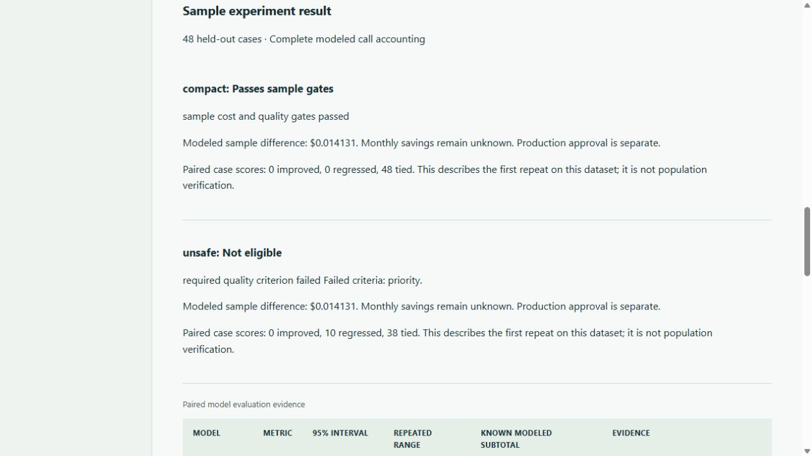

# Cutback

Find where an AI application spends money. Test cheaper alternatives against its quality requirements. Review the evidence before changing anything.

Cutback is an Apache-2.0 Python tool with an offline scanner and a self-hosted collector, PostgreSQL worker and dashboard. **Pre-alpha: synthetic tests demonstrate the workflow; production behavior and real customer savings are not validated.**

## Start with a working application

The support-desk sample routes tickets by category and priority. It shows why a cheaper configuration that mishandles urgent tickets must be rejected.

You need Python 3.11–3.13, uv and running Docker Desktop. The dashboard is already built; no Node setup or provider API key is needed for the sample.

```sh
git clone https://github.com/CutbackAI/cutback.git
cd cutback
uv sync --locked --extra server --extra openai
uv run cutback demo
```

Wait for `Ready:` in the terminal, then click **Explore sample** in the browser.

| Configuration | Expected sample decision | Why |
|---|---|---|
| Baseline | Reference behavior | Classifies ticket category and priority |
| Compact candidate | Passes sample gates | Preserves synthetic labels with lower modeled fixture cost |
| Unsafe candidate | Not eligible | Loses urgent priorities; a required criterion fails |

**All provider responses in the demo are synthetic.** The scanner, native SDK observation, authenticated HTTP collector, PostgreSQL, encrypted evidence, approvals and worker are real. Fixture prices and latency are not real-model benchmarks, invoices or customer savings. No paid inference occurs.

The sample stays available for exploration while the command runs. Inspect calls, modeled usage, scorecards, failed cases, smoke/pilot/test receipts and a source diff with rollback. Nothing is applied or deployed. Press Ctrl+C to remove its own temporary database and encrypted artifacts.



Read [the walkthrough and testing checklist](docs/testing-the-sample.md) for every expected result and troubleshooting. The walkthrough requires dev3 or this source checkout; earlier PyPI pre-alphas do not include the new demo command.

## Try the offline scanner without Docker

```sh
uv run cutback sample support-desk
uv run cutback scan support-desk
uv run cutback opportunities --target support-desk
```

This copies a standalone native-SDK app and owned synthetic cases. Scanning parses files without executing them or making a network request. It finds source call sites; historical usage, spend and quality remain unknown until measured. Add `--json` for machine-readable scan/opportunity output.

## Use your own application

Start with [application onboarding](docs/application-onboarding.md). Keep your dependencies pinned and save findings in that application's ignored `.cutback/` directory. Prepare an instrumentation diff before authorizing its application or deployment.

For runtime observation, connect a scoped ingestion key to your own collector. For optimization, supply permitted examples and explicit quality criteria, review the complete budget, and approve one frozen plan. Metadata is the default; raw content requires a separate active rights policy and encrypted storage. No application name, source or report needs to be published to this repository.

## Define what good means

[Experiment files](docs/experiment-files.md) describe named model/prompt variants, required criteria, optional rubric judging, budgets and staged execution. The dashboard exposes scorecards, segments, descriptive paired comparisons and audited encrypted case reads. Lower cost never overrides a required quality failure; synthetic results never establish customer quality.

## Explore further

- [Other examples](examples/README.md): sync/async/streams, FastAPI, Django, Lambda, workers and Node.
- [Provider compatibility](docs/providers.md): exact supported SDKs/models and limitations.
- [Evaluation](docs/evaluation.md): frozen datasets, independent labels, uncertainty and approval semantics.
- [Deployment](docs/deployment.md) and [privacy](docs/security-and-privacy.md): customer-owned PostgreSQL, scoped credentials, retention and encrypted payloads.
- [Agent workflows](docs/agent-integration.md): portable instructions for supported agent clients.
- [Architecture](docs/architecture.md), [contributing](CONTRIBUTING.md) and [implementation progress](docs/progress.md): internals, executed acceptance and outstanding external gates.

Optional identity, billing, storage, scheduling, routing and training are documented separately. They are not prerequisites for understanding the sample. JavaScript/TypeScript scanning and native Node observation are optional; npm publication is separate. No managed cloud service is operated by this repository.
