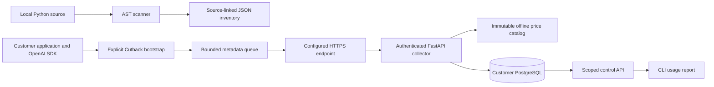

# Architecture

The development implementation uses one Python distribution with separate modules, not one script. This preserves cheap scanner installs while allowing the collector image to install only its own extras. See ADR-013 for the layout decision.

- `src/cutback/core`: strict event/config contracts; no server dependency.
- `scanner`: local AST, bounded files, aliases/constants and conservative call graph. No LLM, imports, prompt text export, historical-usage inference or remote scans.
- `instrumentation`: explicit process bootstrap; pinned resource hooks; native stream iterators; metadata allowlist; OTel parent context; bounded background JSON export.
- `pricing`: checksum-verified immutable seed; exact supported aliases, categories and effective dates; Decimal math. Unknown remains null.
- `server`: FastAPI, separate ingestion/control scopes, PostgreSQL repository, Alembic migrations. No inference, cloud SDK or commercial dependency.
- `cli`: scan/report, instrumentation diff, local stack helper, migration, project/key administration.

The normalized JSON protocol is `1.0`; OTLP ingestion/export is not implemented. Existing OTel parent context is reused without setting a global tracer provider. We do not add payload attributes to third-party spans. Resource wrappers preserve the original result/error and native Stream type. Internal SDK retries are currently one logical SDK operation; this does not satisfy the full per-attempt specification yet. See ADR-012.

The PostgreSQL schema currently contains organizations, projects, environments, access keys, metadata events and audit records. Deferred inventory uploads, workflow registries, aggregates, dataset/experiment/rollout tables will be added through forward migrations when those milestones are implemented. Empty or mock implementations are not presented as those subsystems.

Writes acknowledge after transaction commit. Duplicate `(project_id,event_id)` inserts do nothing. Event batches reject atomically when schema/environment/timestamp validation fails. Cost is determined by the server, never accepted from the sender. Historical valuation is preserved with its snapshot ID. Report tokens distinguish provider-reported from estimated/counted usage. Reports do not extrapolate population coverage or claim invoice reconciliation.

