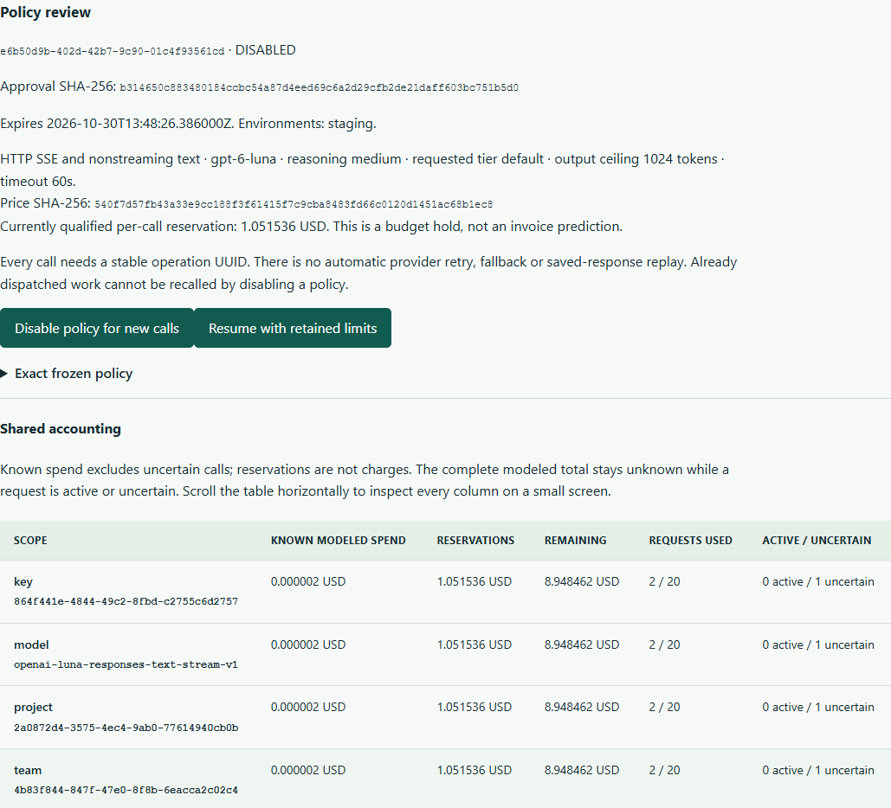

# Application gateway budgets

Working source, unreleased on PyPI. Final installed/archive/hosted acceptance is recorded in [progress](progress.md). Native OpenAI 2.29.0 and the separately pinned 3.35.1 synchronous/asynchronous **Responses text** use synthetic transports. The streaming extension has its own qualification record there. It does not provide universal proxy compatibility, live-provider acceptance or an invoice cap.

## Start with the independent application

Follow [the no-key sample](../examples/gateway/README.md). An ordinary native SDK application calls a real loopback gateway, which reserves shared budgets in PostgreSQL before forwarding to an owned synthetic HTTP transport. The sample includes a completed response, a duplicate operation, missing usage and a second key trying to evade a shared allowance. Neither the provider responses nor their token counts establish real model quality or customer savings.

## Review a finite allowance

Open **Application budgets** in the source-matched dashboard. An administrator prepares an immutable policy with:

- One explicit project, authorized environments and a UTC window of at most 31 days.
- Project, opaque team and qualified model USD/request/concurrency limits. A key adds its own smaller limits and one environment/team/model scope.
- An exact model/request/price reference, reasoning choice, requested `default` tier, output ceiling and timeout. The current adapter accepts text input/instructions, no arbitrary tools, URLs, modalities, stored response state or background work.
- A displayed approval hash and current qualified per-call reservation. Preparing the policy makes no inference call. Approval authorizes the separately enabled gateway; it does not start a process or configure a provider credential.

Approved project windows cannot overlap. Disabling a policy does not free its period for another empty budget. An administrator can explicitly resume an already approved disabled/blocked policy with its exact hash; used requests, all reservations, spent amounts and operation identities stay intact. Resuming does not replay an operation. Expired policies cannot resume.

Control actions also bind the reviewed `expected_state_version`. A new stop advances that version even when the policy is already disabled, invalidating delayed activation requests. A stale stop cannot override a later activation. A lost response is idempotent only while that exact transition remains current; a conflict requires inspecting the changed policy and explicitly choosing a new action. Activation approval UUIDs are consumed once and retained in the policy, with at most 1,024 distinct activation approvals. Reaching that bound cannot reset its window or accounting. New unsafe response evidence advances the review version even when the policy was already blocked; replaying the same settlement does not.

Issue an application key only after approval. Its plaintext is returned once, its digest is stored, and expiry cannot exceed the policy. Gateway credentials do not authenticate the collector control API. Current issuer and approver administration rights, key expiry/revocation, project/environment scope, policy window and model contract are checked before dispatch. Revocation cannot recall a request already dispatched.

The key's immutable traffic purpose separates application, external evaluation, judge, optimization, simulation and unknown traffic. It grants neither content-store rights nor the authority of an internal approved experiment. A gateway receipt cannot manufacture an experiment run or independent quality evidence.

## Reserve before forwarding

All replicas use the same PostgreSQL project mutation lock and durable counters. A reservation must fit **every** applicable project/team/model/key USD allowance, request count and active gateway request ceiling before a call record commits. A new key does not reset shared counters. A durable internal observation starts unpriced, with unknown duration, so a crash cannot hide a potentially charged call from a usage report.

The initial bound uses the model's full supported 1,050,000-token context, its configured output ceiling, the largest qualified write rate, long-context multipliers and the documented Fast premium. It does not guess input tokens from characters or a local tokenizer. These facts come from the [official model documentation checked 28 October 2026](https://developers.openai.com/api/docs/models/gpt-6-luna); the frozen reference binds the immutable price snapshot and the versioned reservation recipe.

For an output ceiling of 1,024 tokens, the bound is `1.051536 USD`: `(1,050,000 × 0.25 × 2 + 1,024 × 0.50 × 1.5) × 2 / 1,000,000`. This is deliberately conservative even for a short request. It is a temporary modeled budget hold, not a price prediction or vendor invoice. Qualified actual Standard model/tier/usage settles the hold to its known modeled amount. Missing usage, failed responses and uncertain billing retain it. Invalid model/tier/units/bounds or unsafe response protocols block the policy pending explicit review.

Project observation price overrides do not silently change an approved gateway's public list-price contract. Unsupported processing, vendor fees and actual invoices are not inferred. Paid/customer acceptance requires separately authorized verification of the intended provider configuration.

## Stable logical operations

Use the ordinary SDK and generate headers once for a logical task:

```python
from uuid import uuid4
from cutback.gateway.client import operation_headers

operation_id = uuid4()  # Retain this identity across retries of this task.
response = client.responses.create(
    model="gpt-6-luna",
    input="your authorized text",
    max_output_tokens=128,
    reasoning={"effort": "medium"},
    store=False,
    service_tier="default",
    extra_headers=operation_headers(operation_id),
)
```

The client uses the explicitly configured gateway base URL and its virtual key. No replacement SDK response or exception type is introduced. Explicit delegation prevents a qualified Python observer from also exporting the same gateway call; local health exposes `gateway_delegated`. Unqualified wrappers/surfaces are not made compatible by adding a header.

The gateway makes no automatic upstream retry or fallback. It returns `x-should-retry: false`, including on normally retryable 409/429/5xx responses. A native SDK retry after transport loss must carry the same operation UUID. The database prevents another upstream dispatch, even when the original response was lost after a successful settlement. A conflicting body or key cannot reuse the identity. Equality uses an HMAC scoped to the logical operation and credential; plaintext bodies and dictionary-attackable content hashes are not retained.

There is no saved-response replay. A duplicate can therefore return a conflict without recovering its original output. Inspect the receipt; do not silently generate a new UUID to repeat an uncertain paid operation. Lease recovery marks uncertainty and retains money; it never dispatches HTTP. Timeouts/cancellation close local transport work but cannot prove that vendor work or billing stopped.



## Separate deployment boundary

The collector never loads gateway provider keys. The optional gateway process defaults to disabled and requires its own explicit enable flag, provider credential, shared HMAC secret and bounded **operator project allowlist**. A valid project policy/key alone cannot bypass that allowlist.

The operator entry point is `python -m cutback.gateway.boot`, with `CUTBACK_GATEWAY_ENABLED`, `CUTBACK_GATEWAY_PROJECTS`, `CUTBACK_GATEWAY_OPENAI_KEY` and `CUTBACK_GATEWAY_HMAC_KEY` (or the corresponding secret-file variables). It uses the reviewed shared PostgreSQL configuration and schema `0020`. The default listener is numeric loopback; public HTTP is refused unless a correctly trusted TLS proxy supplies the scheme. Do not interpret these configuration names as production deployment or paid-call approval.

Only the fixed approved HTTPS provider origin/path is reachable. Incoming organization/project/beta/authorization headers are not forwarded; redirects, ambient proxies, compressed request bodies and unqualified response encodings/surfaces are refused. Requests are capped at 1 MiB with a five-second body deadline, responses at 4 MiB, and model work at the frozen timeout. A bounded per-process admission limit also covers slow response transmission; shared limits remain in PostgreSQL across processes. This is not a production capacity/SLO claim.

## Privacy and retained evidence

Request and response bodies exist only transiently for forwarding. There is no gateway payload capture or plaintext replay cache in this contract. Encrypted capture/import, judging and training retain their separate authorizations. SDK delegation does not grant them. Browser credentials remain in memory; the dashboard has no provider-key field.

Internal event `1.2` permits unknown duration for gateway-owned receipts. Ordinary ingestion rejects this source/version; possession of an ingest key cannot forge a reserved gateway call. Released event `1.0` serialization stays unchanged. Usage reports expose the number of actually timed observations, and unknown durations are never fabricated as zero.

Project export includes safe policies, key metadata, counters and receipts, excluding virtual-key digests and request HMACs. Deletion refuses a currently live gateway dispatch, then removes the complete project scope. Maintenance recovers expired leases, prunes eligible old call records only after their policy expires, and retains aggregate counters/unknown money for the configured aggregate horizon. A late settlement cannot reinsert an expired raw observation beside an archived daily summary. Retained summaries cannot reconstruct missing prices, identities, quantiles or population coverage. Downgrade refuses nonempty gateway intent/accounting; explicit reviewed deletion or expiry is required first.

## Native HTTP streaming

Choose **Native text streaming → Allow HTTP SSE and nonstreaming text** when preparing a new policy. This explicitly freezes `cutback.gateway-policy.v2` and model key `openai-luna-responses-text-stream-v1`. Existing v1 policies retain their exact hashes and reject streaming before dispatch. V2 permits JSON and SSE within one model allowance; it cannot create separate spend buckets for the same SKU. Preparing, approving and issuing a key retain the same current-admin, scope and finite-budget requirements.

Use the same native call above with `stream=True`, then iterate the SDK's own typed events. The [independent application](../src/cutback/sample_app/gateway.py) shows a complete caller: it closes the stream and requires `response.completed` before accepting accumulated text. A partial answer or clean transport EOF without a terminal response is not application success. Optional `stream_options` supports the pinned native `include_obfuscation` boolean; Chat-specific `include_usage`, tools, background work and stored response state remain unqualified. [Official HTTP SSE guide](https://developers.openai.com/api/docs/guides/streaming-responses).

The gateway forwards bounded native event bytes, including unknown native response extras, rather than rebuilding response objects. Total wire content is capped at 4 MiB, one event frame at 1 MiB and data events at 16,384. It accepts LF, CRLF and CR delimiters, fragmented UTF-8 and multiline SSE data. Malformed/duplicate JSON, unsupported content/items and invalid final usage retain uncertainty; unsafe protocol/contract evidence blocks the policy for explicit review. It never retains content, deltas or obfuscation padding. Native initial HTTP errors preserve their status and the no-retry header. Interrupted streams emit an explicit gateway error when transmission permits; a disconnected socket may prevent delivery, so callers must still check completion.

The frozen deadline spans upstream headers, reads and downstream backpressure. Closing or cancelling a stream closes local upstream transport and durably classifies the call. Only a completed response with fully qualified final usage settles before its terminal event is forwarded. Missing usage keeps the full hold even if some text arrived. Failed/incomplete terminal responses retain their reported token fields and error/incomplete status, but the existing conservative pricing contract leaves their full cost unknown and retains the hold. A disconnect after known final usage preserves that known settlement. A lost database acknowledgement may retry only that exact metadata receipt; it never repeats provider HTTP. The provider cancellation endpoint is not invoked: it applies to background responses, outside this store-false contract. Closing a connection does not establish that vendor billing stopped. [Official cancellation contract](https://developers.openai.com/api/reference/python/resources/responses/methods/cancel).

Each call receipt exposes nullable `streaming` and `first_text_delta_us`. The timing uses a gateway monotonic clock from upstream dispatch to the first nonempty native text delta, captured before forwarding it. It excludes the customer's network and is not a measure of full application response time or individually generated token time. The dashboard displays its milliseconds alongside known/unknown modeled cost. Refusals, streams with no text and legacy records retain unknown timing. Migration `0020` adds nullable fields without backfilling evidence; downgrade refuses surviving v2 intent or stream evidence. Timing follows call-record retention/export/delete and is not reconstructed from aggregate summaries.

Remaining work includes more models/providers/surfaces, qualified reliability/fallback policies, intended deployment/load/secret rotation operations and independent user/customer acceptance. The broader product roadmap is not complete.
