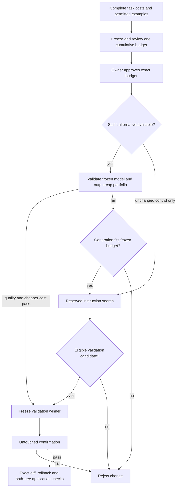

# Automatic improvement campaigns

Locally accepted source-checkout functionality; hosted/publication gates remain in the progress record. The published PyPI dev5 wheel does not contain these commands. See [executed acceptance and publication state](progress.md). This is a bounded native text workflow; it does not complete every optimizer or the platform roadmap.

Start with the [independent runnable classifier](../examples/improvement-campaign/README.md), or ask a coding agent in an authorized application workspace:

> Use Cutback to prepare a source-bound improvement campaign. Discover supported workflows and permitted examples, preserve the request/output contract, compare the unchanged reference and simple downgrade against generated instruction/output-cap variants, and choose search effort from complete task costs and my conservative opportunity assumptions. Show the exact total budget before any paid execution. Resume the same campaign after interruptions. Confirm one frozen winner on untouched groups, prepare its exact diff and rollback, run my authorized application checks for every affected consumer and prepare a local review branch. Do not deploy, publish or invent business results.

## Prepare without inference

New v3 preparations freeze up to four qualified model/output-limit alternatives and follow this stopping rule. Each box uses the same frozen source/data authority and cumulative parent budget; arrows do not authorize paid calls or application deployment. Existing v2 campaigns retain their single static alternative.



Run `cutback optimize . --json`, then [prepare the selected source-bound workflow and permitted examples](agent-workflow.md) with `workflow prepare --for-campaign`. Inspect the installed help first: published dev5 lacks this flag and the campaign commands. Preparation preserves the native request, imports only authorized examples and creates a validation basis without running inference. It chooses a simple model downgrade when one exists; an application already on the cheapest qualified model can use an output-bound alternative, or an explicitly labelled unchanged control at the minimum cap. An unchanged control is not a claimed optimization. Use `campaign prepare` next; `workflow continue` refuses to execute this basis as a static experiment.

For an Anthropic target, `--campaign-generator-provider openai` explicitly includes OpenAI in the capture policy's permitted vendors for the proposer. Supply it only within actual data/vendor authorization. Missing permission fails before reading examples or creating an upload policy. The permission persists for resuming that same frozen preparation and rights reference; changing vendors/rights requires a new preparation and paid campaign approval. OpenAI targets already include that vendor. Preparation does not authorize paid inference.

Metadata observation and task-outcome declarations produce [complete task-cost snapshots](task-economics.md). The snapshot must match the same environment/workflow/service/release. Native LLM costs alone cannot stand in for unknown tool or other required task costs.

The agent may locate an existing matching snapshot through the scoped API. Future volume and conservative savings per successful task remain owner assumptions. Missing/incomplete economics abstain without provider calls; the agent must not fabricate these inputs.

```sh
cutback campaign prepare --baseline-snapshot SNAPSHOT_UUID \
  --max-usd 2 --max-requests 500 --rounds 2 --variants-per-round 2 \
  --savings-per-success 0.001 --forecast-successful-tasks 10000
cutback campaign status
```

These illustrative amounts are not paid authorization. Preparation freezes the dataset, source/request contract, literal instruction edit when qualified, generator version, eligible providers/models, allowed instruction/output bounds and cumulative request/dollar/wall-time ceilings. The compiler includes generation, reference/static/generated validation, judging and worst-case confirmation. It narrows effort to fit the conservative opportunity and request caps. It also budgets proposer input capacity for all permitted prior candidate versions and aggregate feedback; it never silently widens the approved input contract. Unknown or insufficient opportunity abstains.

New CLI and dashboard preparations explicitly use `cutback.improvement-campaign.v3`: derive and freeze up to four distinct qualified model/output-cap alternatives **before approval**, then validate them together against the unchanged reference before calling the instruction proposer. The dashboard lists each model, output-token ceiling and worst-case request cost. These are candidate bounds, not observed savings. The least expensive eligible validation candidate goes straight to independent confirmation. If none qualifies, the campaign advances into only the prompt-search rounds already reserved in that same envelope. The proposer may use the exact frozen portfolio seeds; it sees their aggregate validation feedback, never validation/test examples. If only portfolio validation plus confirmation fit, the compiler freezes zero generation rounds; failed validation then rejects the change without a proposer call. It never shrinks held-out samples to buy more search. Failed confirmation ends the campaign; it cannot reopen search on the consumed test groups.

The metadata receipt explains the selected search order, initial request reservation, generation eligibility and subsequent decision. Cumulative costs include initial static trials, generated trials, judging and confirmation. These bounds cover native provider calls, not unmeasured local planning, review, infrastructure or other overhead; they are not a complete payback claim. A static pass avoids proposer API calls, not every optimization cost.

Before approval, v3 tries the requested portfolio's deterministic prefixes from largest to smallest. It freezes the largest prefix whose complete validation, possible generation and worst-case confirmation fit the declared opportunity/request limits. The receipt records requested count, selected keys and omitted keys. A smaller search portfolio never means fewer held-out validation or confirmation examples. If even one alternative plus confirmation cannot fit, preparation abstains. The selected portfolio and effort become part of the immutable approved payload; no later worker can restore omitted choices or extend its budget.

When preparation has no distinct qualified static alternative, it skips the duplicate static comparison and proceeds to the reserved instruction search. It also avoids repeating failed static alternatives in each generated round: each round compares the unchanged reference against its new generated candidates. Prior static validation remains in the encrypted history and cumulative accounting. The proposer receives only typed aggregate feedback; skipping generation does not expose training content. Later outcome receipts retain the whole versioned run family, including the two-run static-success path or up to eight runs for static validation plus three generated rounds and confirmation.

Previously saved campaigns retain their exact version, hash and execution order on resume. Direct API requests omitting a version retain v1 generation-first behavior. `campaign prepare --generate-first` explicitly selects that legacy order for a new CLI campaign; changing an existing frozen campaign requires a new preparation and approval. API clients select v3 through the `version` field in `/campaigns/draft`; the full v3 specification requires an explicit `static_portfolio` (zero to four alternatives). Legacy v1/v2 serialization omits that new field and preserves its hashes. V3 preserves provider, native request/options, instruction and input bounds; its static candidates must have a lower worst-case native request cost. The existing retrieval/compression engines are separate approval workflows and are not silently dispatched by this text campaign.

Current generation supports pinned native OpenAI Responses structured output. Targets support the qualified OpenAI Responses and Anthropic Messages text profiles. Dynamic tools, streams, arbitrary optimizer callbacks, cross-provider target migrations and unqualified request transformations are not included. Exact same-file literal instruction replacement/insertion is the first source-edit adapter. Imported model configuration, dynamic instructions and other source/registry layouts need separate qualification; evaluation evidence alone cannot authorize a guessed edit.

## Approve once and resume

After actual owner approval of data rights, vendors and the displayed paid ceilings:

```sh
cutback campaign continue --campaign-hash EXACT_HASH --approval-reference actual-owner-review
cutback campaign continue
```

The configured operator worker performs the journey. For the same owned local stack, run the already approved campaign to its terminal state:

```sh
cutback campaign run
cutback campaign status
```

`run` does not approve a pending campaign or allocate another campaign, experiment family or budget. It keeps the original approval hash, cumulative reservations and wall deadline. It performs at most eight local child-operation attempts, enough for static validation, three proposal/validation rounds and confirmation. `--max-operations 1` intentionally stops at a local operation boundary; rerunning resumes the same campaign. This limit counts local child-job attempts, not native requests, and does not suspend other already authorized workers. The frozen parent/child request and dollar ceilings remain authoritative.

Both `run` and the single-step `campaign work` verify the saved local destination, exact project/campaign/hash and current source profile before executing work. A changed source or destination stops execution. Lease recovery and expiry are scoped to that campaign and run before provider credentials are constructed. An expired reserved call becomes uncertain; the driver fails that campaign without replaying it. Cancellation stops new calls, while a late known bill remains part of the original ledger. The driver also has a monotonic wait bound and never extends the original paid deadline.

Each local execution step isolates Decimal precision, rounding and signal traps for its native budget/accounting calculations, then restores the caller's settings. Embedding the driver in a Python process with restrictive arithmetic settings must not change the approved costs or cause a valid trial to fail solely because of that ambient context.

These commands use real providers when worker BYOK credentials are configured. The independent samples inject owned native HTTP transports into the **same driver** and require no provider key; this is an explicit sample boundary, never an automatic fallback to a real key. Cancellation uses `cutback campaign cancel`. Completion means the frozen evaluation journey ended: the recorded decision may still reject the change or require representative data and application checks. It does not authorize deployment.

`campaign run` writes one final JSON result to stdout and metadata-only JSON-line progress to stderr. Scripts can parse the final object directly; inspect its `status`, `operator_code` and `decision`, rather than treating a finished process as evidence of a successful improvement. Cumulative request/known-cost counters and spend subtotals belong to the entire campaign and may include other authorized workers. They are not claimed as calls made solely by this local process.

Every physical generation/target/judge request reserves against both the exact child plan and cumulative campaign in the canonical PostgreSQL transaction. There is no budget reset between rounds. Repeated continuations reconcile the same identity. Expired/crashed leases fail uncertain billable work without automatic replay, including when inference is disabled. Cancellation stops new calls; later known usage repairs accounting without restoring authority.

The proposer sees authorized training examples, prior generated configurations and typed aggregate validation feedback. It never receives held-out inputs, labels or raw validation outputs. Versions are encrypted and frozen before evaluation. Repeated configurations retain their version/disposition but skip duplicate evaluation. The worker freezes one validation winner and consumes untouched confirmation once. Cheap-but-worse, failed confirmation, incomplete accounting and stale lineage block a usable proposal.

## Prepare the exact change and application checks

```sh
cutback campaign proposal --purpose-reference actual-change-review
```

After an operator's separately authorized application release, [link later task outcomes](campaign-outcomes.md) with `campaign observe`. It reuses the reviewed diff, original baseline and canonical run family, preserves unknown external costs and prepares an operator review action without changing traffic.

This performs an audited current-policy content read, revalidates confirmation/lineage and local source hashes, and returns the exact source diff and rollback. It changes no application file. `--sample-only` is available for owned fixtures; it keeps the evidence explicitly sample-only and cannot establish independent/customer quality.

The coding agent reviews the diff and prepares **two independent clean Git checkouts**, one at the original source and one with only the proposed evaluated source change committed. It freezes and explicitly runs [portable application checks](application-checks.md) under the application's execution authorization. Commands execute locally with a minimal environment and bounded processes, not in the collector. They are not an OS/network sandbox. Keep credentials and production access out of that worker.

Provide a private JSON coverage mapping from every returned `affected_workflows` identity to existing command keys, for example `{"app.py:classify":["classifier-contract"]}` using the actual identities. The mapping is owner-declared coverage; a passing command is not independent proof of semantic coverage. Scanner warnings or unresolved consumers require separate qualification rather than a false all-clear.

```sh
cutback campaign review --purpose-reference actual-application-review \
  --contract PRIVATE_CONTRACT_JSON --receipt PRIVATE_RECEIPT_JSON \
  --base-root BASE_CHECKOUT --proposed-root PROPOSED_CHECKOUT \
  --workflow-coverage PRIVATE_COVERAGE_JSON \
  --local-review-branch cutback/reviewed-improvement
```

Review refreshes current confirmed evidence, verifies the receipt and both current source trees, matches the exact before/after source hashes, rejects extra file changes and requires every detected affected consumer's declared checks to have passed in both phases. The optional branch creates a local ref at the exact checked proposed commit. An existing different ref is never overwritten. No push, PR submission or deployment occurs. A coding agent can then prepare the PR description from the evidence, scope, application checks, full optimization overhead and rollback; remote publication remains within the application's separately granted authorization.

Receipts contain hashes/metadata, not instructions, provider keys or application test output. Local receipts are not cryptographic third-party attestations. Protect authorized diff/content output under the application's private controls. Retention of individual costs cannot reconstruct missing campaign context or unknown overhead. Real task success, model availability, future payback and customer savings need separately authorized representative evidence.
