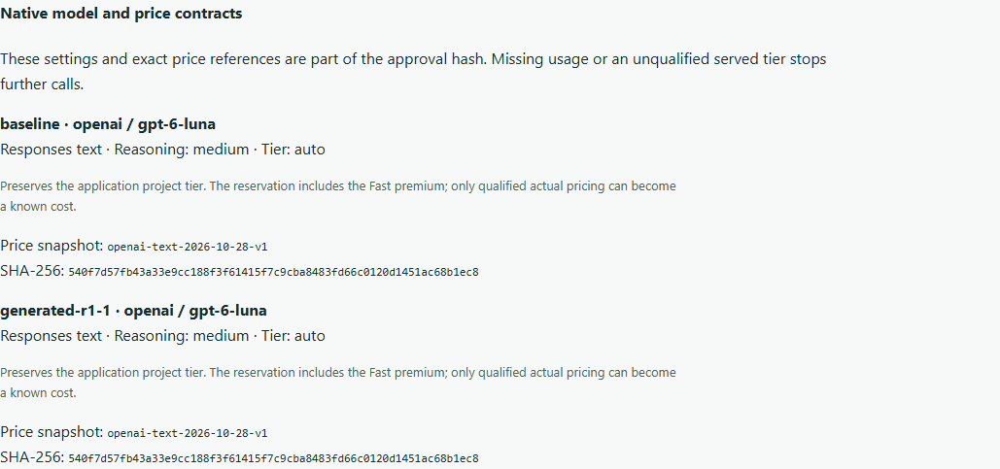

# Native modern-model text experiments

This source addition separately qualifies GPT-6 Luna for synchronous, nonstreaming Responses text experiments through OpenAI 2.29.0 and 3.35.1. It does not add Luna agent turns, Chat execution, images, built-in tools, async/streaming replay, regional processing or arbitrary request options. Observation and prices alone do not authorize an experiment. PyPI `0.1.0.dev5` does not contain this addition.

## Run the independent application

Use the [owned local collector setup](../examples/improvement-campaign/README.md), with explicitly authorized encrypted example storage. From a source checkout:

```sh
python examples/improvement-campaign/sample.py --local-target OWNED_LOCAL_TARGET --outcomes --modern-model
```

This copies an independent Luna application into its own private example workspace. Ordinary agent preparation derives a source-bound contract, prepares the campaign and confirms a candidate through the canonical PostgreSQL ledger. Application checks are discovered, frozen and run on original/proposed source. A reviewed change is linked to later declared synthetic outcomes; the deliberately worse window recommends reviewing rollback. No application is deployed. `--watch` can also exercise the finite metadata-only observation policy.

Every provider request is intercepted through actual pinned SDK transports. Answers, usage and later economics are synthetic. The Luna proposer has a separate contract and accounting from the application: its owned request explicitly selects nonreasoning Standard processing, while the application retains its source/default choices. The fixture generates distinct variants even when seeds share one model. This validates the product journey, not live model quality, payback or customer savings.

## Preserve native choices

For qualified Responses source, `workflow prepare --for-campaign` derives the reference without a hand-written plan. It preserves supported reasoning and tier choices. When absent, the checked [model default](https://developers.openai.com/api/docs/models/gpt-6-luna) is `medium` reasoning; the checked [API default](https://developers.openai.com/api/reference/resources/responses/methods/create) is the application project tier through `auto`. Preparation freezes those choices instead of substituting a nonreasoning or Standard-only baseline.

Qualified reasoning efforts are `none`, `low`, `medium`, `high`, `xhigh` and `max`. Requested tiers are `default` and `auto`. Explicit Fast/Flex/other tiers and unsupported sampling/options require separate qualification. Source preparation stays offline and parse-only; it does not import the application or bypass content authorization.

Standalone authors can prepare metadata without an API call:

```python
from cutback.core.native_models import NativeModelContract
from cutback.evals.experiments import ModelSpec

baseline = ModelSpec(
    key="baseline",
    provider="openai",
    model="gpt-6-luna",
    native_contract=NativeModelContract.current_luna_text(
        reasoning_effort="none", service_tier="default"
    ),
)
```

The reference binds `openai-luna-responses-text-v1` to the exact immutable secondary price snapshot and SHA-256. Settings participate in the encrypted plan and approval hash. A model name alone remains ineligible. Legacy serialization omits the extension entirely, preserving plan hashes and primary execution prices. Explicit operator catalogs do not silently fall back to this bundled contract.

## Approvals and uncertain costs

Review the native settings, snapshot and SHA on **Experiments**, alongside the maximum budget and approval hash. Planning summaries also return these references. Approval permits one queued run; it does not enable workers, configure credentials or deploy a source change.



Before each call, execution checks the approved contract, current price reference, provider/model/surface and token bounds. Requests use the selected reasoning/tier, `store=False`, an explicit thirty-minute write option and no automatic retries. Reservations cover the largest qualified write rate and applicable context multipliers. `auto` also reserves the documented Fast premium because project settings can select it. This reserve is not an invoice or a claim that Fast usage is qualified.

The response model must match the approved Luna model; its served tier must have qualified Standard pricing. Missing tier evidence, unsupported served tiers, incomplete write durations, missing usage and incomplete outputs leave cost unknown. One uncertain call retains its reservation and stops further work. A consumed approval cannot be reused. Native receipts retain the per-model price SHA; legacy calls retain their primary reference. Proposer overhead stays separate.

Content rights, current approving principal, privacy, held-out confirmation, retention, export/delete and application checks still apply. A bounded check runner is not an OS/network sandbox. No real provider requests are part of this example or test suite.

## Acceptance state

Actual SDK transports, reasoning/tier requests, missing usage, wrong served model, pre-HTTP rejection, one-shot PostgreSQL reservations and the native campaign/check/outcome journey have synthetic tests. The dashboard requires authenticated desktop/mobile/accessibility acceptance. Final installed/archive/publication evidence is in [progress](progress.md). Broader provider/model coverage, optimization strategies, gateway controls and launch/customer acceptance remain unfinished.
